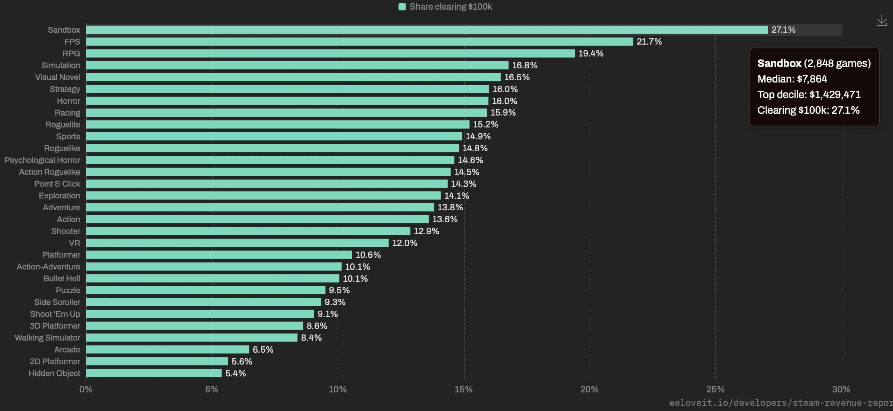
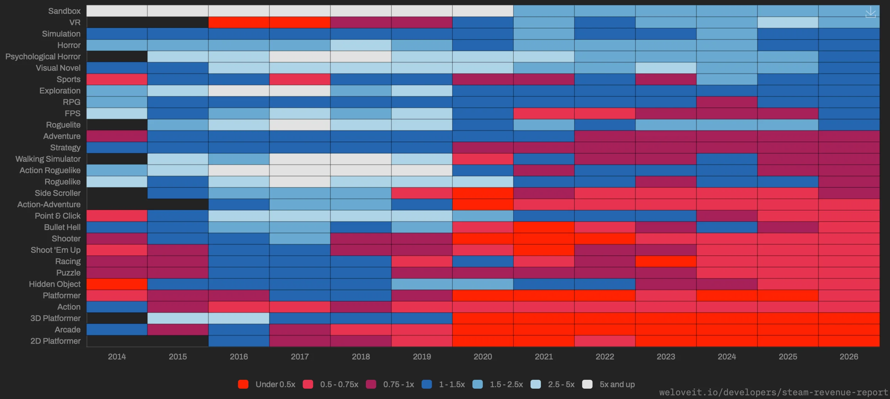
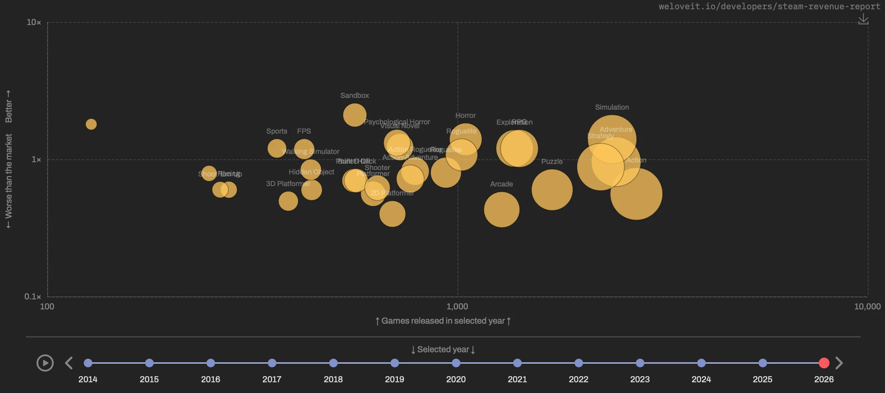
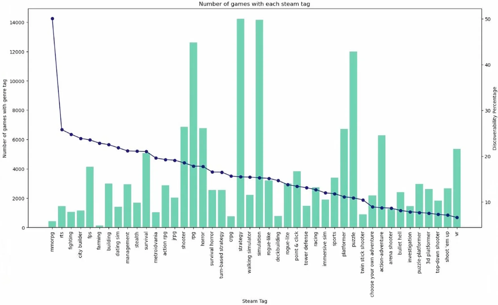
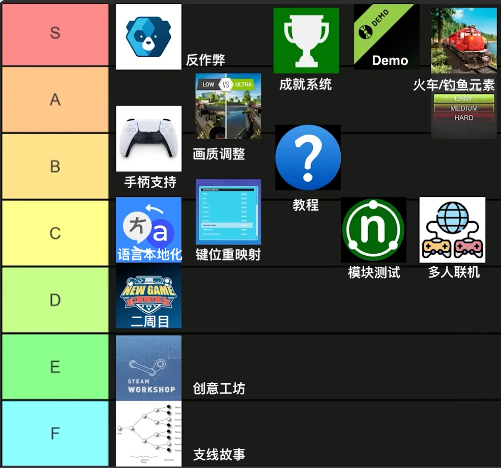
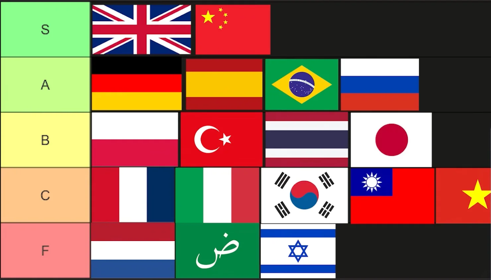

---
{
  title: Indie Game入行准备,
  date: 2026-09-21,
  publishedAt: 2026-09-21T13:21:36+08:00,
  updatedAt: 2026-09-21,
  tags: [ 游戏, 设计 ],
  draft: true,
  archive: true,
  badge: 游戏
}
---

做独立游戏也是一门学问，不是一拍脑袋，一腔热血就能做成的。现在新游戏非常多，想要突出重围也要有方法地去做。

## 品类

什么游戏品类最好做呢？可以看一下[这个网站](https://weloveit.io/developers/steam-revenue-report/)，里面对各种类型游戏进行统计。

| 比较项目 | 沙盒类 | FPS | RPG | 视觉小说 | 模拟 |
| --- | --- | --- | --- | --- | --- |
| 到达$10k的比例 | 1 | 2 | 3 | 5 | 4 |
| 最高10%的收入 | 1 | 2 | 3 | 7 | 4 |
| 中位数收入 | 1 | 10 | 4 | 2 | 3 |

沙盒类型就是全面碾压的，这件事换个角度思考也很容易理解。游戏的发展历程就是**地图越来越大、内容越来越丰富**。枪战从小地图的CS到大逃杀/搜打撤。赛车也送赛道变成地平线这种超大地图。

还有一个发展趋势就是**沉浸式体验更好**，也就是游戏能给玩家带来更多现实中体验不到的故事/事情。所以RPG、模拟、视觉小说表现都非常不错。

第一张图的蓝海：沙盒、VR、模拟、恐怖、心理恐怖、视觉小说、体育、探索、RPG、FPS。但是结合第二张图的趋势看，VR已经没落，基本是少数赢家“通吃”，恐怖类型游戏偏多。结合两年来看实际上比较好就是左上角这些：**沙盒、体育、视觉小说、心理恐怖**。（心理恐怖比较好的例子是《米塔》）

[这个视频](https://www.youtube.com/watch?v=FA4haoZg_oc)很直接地说出了和以上分析完全一致的结论。

适合独立开发者的游戏类型是**开放世界生存、制作、建造类型游戏，模拟，恐怖游戏。FPS和RPG游戏也深受欢迎，但需要有大量的内容才可能成功**。应该避免做平台游戏、Puzzle、VR。

## 艺术风格

查看这个视频：https://www.youtube.com/watch?v=yXh4d0lEzaQ

| 艺术风格 | S | A | B | C | D |
| --- | --- | --- | --- | --- | --- |
| 像素 | 3 |  |  |  |  |
| 低多边形3D | 2 | 1 |  |  |  |
| 单色 | 2 | 1 |  |  |  |
| 向量图 | 1 |  | 2 |  |  |

这个[视频](https://www.youtube.com/watch?v=cn7n1mF6Ejw)只从艺术表现分析，低多边形也处于中间档（注意，不要使用被滥用的资源素材）。

要注意以上分类其实比较粗糙，通常用来区分那些制作方式存在较大差异的表现方法。所以即便使用相同的艺术风格类型制作，也可能产生非常不同的艺术表现。

总的来说，对于初学者/入门最好的艺术风格就是**像素（2D）和低多边形（3D）**。单色的普适性相对差一些。

## 功能取舍

下图源自[这个视频](https://www.youtube.com/watch?v=0Ks54W2_XrQ)

:::info[《人类一败涂地》也没有一开始就做多人]
多人游戏对于网络有很高要求，物理碰撞越多，同步越困难。
:::

### 本地化语言

下图源自[这个视频](https://www.youtube.com/watch?v=vsEqWCxhN80)

## 实用的网站

- 营销时间线：https://howtomarketagame.com/benchmarks/
- 相似游戏的优缺点: https://deepnight.net/games/game-feel/
- 找适合的游戏KOL: https://whoplays.games/
- Twitch analytics: https://sullygnome.com/
- Steam评论提醒 https://www.steamreviewalert.com/
- 帮助填Steam游戏Tag: https://steamtaghelper.com/
- 语言本地化相关的一个文档:https://docs.google.com/spreadsheets/d/17f0dQawb-s_Fd7DHgmVvJoEGDMH_yoSd8EYigrb0zmM/edit?gid=310116733#gid=310116733
- 专业语言本地化: https://www.localizedirect.com/
- 众包语言本地化: https://www.localizor.com/
- 制作手柄映射图: https://www.padcrafter.com/

以上部分网站来自[视频](https://www.youtube.com/watch?v=VJVIjxLzcfs)